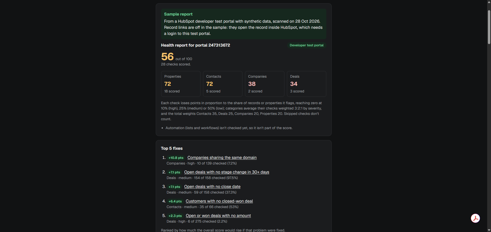

# Portal Health Auditor

**Live demo: [portal-auditor-two.vercel.app](https://portal-auditor-two.vercel.app/)** · [Sample report](https://portal-auditor-two.vercel.app/demo)

[](https://portal-auditor-two.vercel.app/demo)

A web app that connects to a HubSpot portal with a read-only service key, scans it for data and configuration problems, and returns a health score with a ranked fix list.

**Status:** early build. The app runs property and record checks on contacts, companies and deals, scores the portal out of 100, lists the top 5 fixes, and exports CSVs and a step-by-step cleanup playbook (PDF).

The deployed site is **demo-only**: it shows a sample report from a HubSpot developer test portal and never accepts a service key. To scan your own portal, [run it on your machine](#run-it-on-your-own-portal).

**Properties**
- Custom properties with no description
- Custom properties filled on under 1% of records
- Duplicate or near-duplicate property labels
- Dropdown options on custom properties that differ only by case, spacing or punctuation, or are singular/plural of each other

**Contacts**
- Missing lifecycle stage
- Lifecycle stage Customer with no closed-won deal
- Missing email
- Malformed or mistyped email (e.g. `gmial.com`)
- Likely duplicates: same first name, last name and company name

**Companies**
- Duplicate domains
- Companies with no associated contacts

**Deals**
- Open or won deals with no amount
- Open deals with no close date
- Open deals with no stage change in 30+ days

Each finding shows a severity, a count, its rate (how many of the records or properties checked were affected), the points fixing it would add to the score, up to 10 samples (property names, or record IDs linked to HubSpot), why it matters and how to fix it. Sensitive and highly sensitive properties are not audited.

## Health score

The report opens with a score out of 100, a score for each category, and the top 5 fixes.

- **Each check scores by rate, not count.** Rate = records (or properties) affected ÷ records (or properties) checked. A check scores 100 at 0% and loses points in a straight line until it reaches 0 at 10% for high-severity checks, 25% for medium and 50% for low. Because it's a rate, a 250,000-contact portal isn't marked down for being big: 2% of contacts missing an email scores the same at any size.
- **What each rate is measured against.** All contacts or companies for presence checks; Customers for "Customer with no closed-won deal"; open deals for missing close date and stale deals; open or won deals for missing amount; the recent-records window for duplicate and email checks; custom properties for property checks. Duplicate checks count records in duplicate groups, so a group of six weighs more than a pair.
- **Categories** average their checks, weighting high, medium and low severity 3:2:1. **The overall score** weights Contacts 35, Deals 25, Companies 20 and Properties 20. Automation (lists and workflows) isn't checked yet, so it isn't scored.
- **Skipped checks don't count.** A check that can't run (a missing scope, a property the portal doesn't have, no records yet) is left out, its weight is shared among the checks that ran, and the report lists it as not scored.
- **Top 5 fixes** are ranked by points recovered: how much the overall score would rise if that problem were fixed.

All weights and zero-points live in `src/config/scoring.ts`. The one-line explanation on the report is built from that file, so it always matches.

## Cleanup playbook

After a scan, and on the sample report, **Download playbook (PDF)** gives a step-by-step cleanup guide and **Download everything (ZIP)** gives the playbook plus every CSV from that scan in one folder. Both are built in the browser from the report on the page; nothing is sent to the server or stored. The PDF code (pdfmake, about 1.6 MB) loads only when one of these buttons is clicked.

- **Cover:** portal, scan date, overall and category scores, the Top 5 fixes, and "HubSpot steps verified against HubSpot's documentation on <date>", the oldest verification date among the steps it uses.
- **One section per finding, biggest score gain first:** what's wrong, why it matters, how to fix it in HubSpot (the index-page filter, settings path and bulk action), and which CSV to use. When a HubSpot filter finds every affected record, it says "No CSV needed" and gives the filter. Only mistyped emails and duplicates need a CSV, because no filter can find them. Stale deals and deals missing an amount or close date also say how to split the work by deal owner. Each section ends with the HubSpot pages it relies on.
- **Appendix A** describes each CSV column by column. **Appendix B** gives the import steps: Record ID, Update existing records only, a contact segment for contacts, or a "Cleanup reason" property for companies and deals.
- **Plain black and white**, so it prints and photocopies cleanly. Characters the bundled font can't draw (arrows, Japanese, Chinese, Korean) print as "?" and the section says so.
- **No record values:** record IDs stay in the CSVs, and the PDF holds only check text, property names, counts and portal details. No owner names or IDs anywhere.

### Where the HubSpot steps come from

Every menu path, filter name and fix step lives in one file, `src/config/hubspot-guidance.ts`. Each entry has its HubSpot knowledge-base URL, short verbatim key phrases from that page, and a `lastVerified` date. Advice HubSpot's docs don't cover (only "correct each mistyped email") is marked `general` and labelled "General guidance" in the PDF.

- `npm run check:hubspot-docs` fetches every source page, fails any that redirect, return an error or no longer contain their key phrases, and always exits 0.
- A weekly GitHub Action (`.github/workflows/hubspot-docs.yml`, Mondays, or run it from the Actions tab) runs the same check and opens one issue labelled `hubspot-docs` listing anything that failed, or comments on the open one. It never fails a build or a deploy.
- `npm test` warns, without failing, when an entry's `lastVerified` is more than 90 days old.

When a page changes, re-read it, update the entry's text, source and key phrases, and set `lastVerified` to that day.

## Exports

CSV downloads, built in the browser from the report on the page. Nothing is sent to the server or stored.

- **Findings summary:** one row per finding with check, object, category, severity, count, records affected, population, rate, points recovered, why it matters and how to fix it.
- **Records work list:** one file per object with record ID, object type, check, severity, duplicate group, HubSpot record link, a capped marker and a prefilled cleanup reason (for example "Portal audit 2026-10-28: Contacts with no email address"). Record IDs only: no names, emails, owners or other field values. Records in the same duplicate group share a group number.
- **Import files** (in the ZIP, under `imports/`): one per finding that needs a CSV (mistyped emails, duplicate contacts, duplicate companies), one row per record with Record ID, Cleanup reason and, for duplicates, the group number.

Count checks page through the matching records during the scan, 200 per call, up to 1,000 per check (`records.workListCap` in `src/config/checks.ts`). When a check matches more, its rows say "first 1,000 of N" and the report notes it. The service key is discarded after the scan, so IDs can't be fetched later. Duplicate and email checks use the IDs already read from the recent-records window.

## Using the work list in HubSpot

HubSpot can import the work list by Record ID to find or tag these records. Imports write to the portal, unlike the auditor, so try it on a test portal first. Steps, per HubSpot's [import guide](https://knowledge.hubspot.com/import-and-export/import-records-for-a-single-object):

1. Go to **Data Management > Data Integration** and start an import, or click **Import** on the contacts, companies or deals index page. Import one object's file at a time.
2. Map the **Record ID** column to the **Record ID** property. Record ID takes priority over other identifiers such as email or domain.
3. Choose **Update existing records only**, so rows that don't match an existing record are ignored and nothing new is created.
4. Set columns you don't want written to **Don't import**.
5. Then either:
   - **Contacts:** on the final step, tick **Create a contact segment** to get a segment (list) of exactly these contacts.
   - **Any object:** first create a single-line text property such as "Cleanup reason", then map the Check column to it during the import. Then filter a view or build a segment on that property.

Remove the property or segment when the cleanup is done.

## Run it on your own portal

Scanning runs on your own machine, so your service key never leaves it except to call HubSpot. No configuration file is needed.

1. Install [Node.js](https://nodejs.org) 22.9 or later.
2. Get the code: `git clone https://github.com/davidlionel/portal-auditor.git`, or [download the ZIP](https://github.com/davidlionel/portal-auditor/archive/refs/heads/main.zip) and unzip it. Open a terminal in the project folder.
3. Run `npm install`, then `npm run dev`.
4. Open http://localhost:3000.
5. Paste a service key and click **Run scan**. Create the key in HubSpot under **Development > Keys > Service keys**, ticking only the six read-only scopes below. Start with a developer test portal or sandbox rather than a portal with client data.

The key is pasted into the page for each scan and never saved.

### Scopes to tick on the service key

| Scope | Used for | Why |
|---|---|---|
| `crm.schemas.contacts.read`, `crm.schemas.companies.read`, `crm.schemas.deals.read` | `GET /crm/properties/2026-09/{object}` | List property definitions: labels, descriptions, dropdown options |
| `crm.objects.contacts.read`, `crm.objects.companies.read`, `crm.objects.deals.read` | `POST /crm/objects/2026-09/{object}/search` | Count records for fill rates and record checks; read name, company, email and domain on recent records for duplicate and email checks |
| none listed in HubSpot's docs | `GET /account-info/2026-09/details` | Confirms which portal is connected (Hub ID, account type, data center) |

Every scope is read-only. If one is missing, the scan skips that object or check and says so in the report.

### Deploying your own copy

Live scanning is on by default, except on Vercel: the app turns it off when Vercel's automatic `VERCEL` environment variable is present, which is how the public demo shows the sample only, refuses keys and needs no setting. To accept keys on your own Vercel deployment, add the environment variable `ENABLE_LIVE_SCAN=true` and redeploy (the home page reads the setting at build time; the scan endpoint checks it on every request). `ENABLE_LIVE_SCAN=false` turns scanning off anywhere. The `VERCEL` variable is only set when the project's **Enable access to System Environment Variables** setting is on, which is the default; `npm run check:deploy -- <url>` confirms a deployment refuses keys.

### Refresh the sample report

This is only for maintainers replacing the sample; scanning doesn't need it. The sample report at `/demo` is a saved scan of a developer test portal (`src/demo/snapshot.json`). To replace it with a scan of your own test portal, create a file named `.env.local` in the project folder (it's gitignored) containing that portal's key:

```
HUBSPOT_TOKEN=<service key>
```

then run `npm run demo:snapshot`. The script is the only thing that reads `HUBSPOT_TOKEN`. The script scans the portal, refuses anything that isn't a developer test portal, and checks the result contains only record IDs, property names and labels, counts, check text and portal details (no names, emails, phone numbers or other record values) before saving it with the scan date. The sample page re-scores the snapshot with the current scoring settings, and shows record IDs without links, since links into HubSpot need a login to that portal. The site won't build without a snapshot.

### Simulated 250K portal (development only)

To watch a full-size scan without a big portal, turn on the built-in simulator. Create a file named `.env.local` in the project folder (it's gitignored) containing:

```
ENABLE_SIMULATOR=true
```

Then run `npm run dev`. A **Run simulated 250K scan** button appears under the key field. It scans a fake portal (250,000 contacts, 30,000 companies, 15,000 deals, 300 custom properties) with HubSpot-like response times and occasional rate limits, so it takes about two and a half minutes. The progress bar and the report show a **SIMULATED PORTAL** banner, and no HubSpot calls are made. Delete the line or the file to turn it off.

The simulator only runs when **both** are true: the app is a development build (`npm run dev`) and `ENABLE_SIMULATOR=true`. A production build (`npm run build` then `npm start`, or a deployment) ignores the flag, even though Next.js reads `.env.local` there too. The simulator code runs only on the server and never reaches the browser.

## Tests

```bash
npm test
```

Unit tests run each check, the scoring, the CSV exports, the playbook, its PDF and ZIP, the HubSpot guidance file, the 429 retry logic, the progress bar's maths, the scan endpoint and the simulator guard against fixtures, with no HubSpot key or network. They use Node's built-in test runner through [tsx](https://tsx.is). They cover known false positives that must stay unflagged (Japanese / Javanese dropdown options, "Region 1" / "Region 2" labels), the cases that must be caught (Webinar / webinar), and the 30-day age rule for fill rate. Each check takes an optional config, so tests can try other thresholds without changing the ones the app uses. The playbook tests render the real PDF and read its text back with [unpdf](https://github.com/unjs/unpdf), unzip the real ZIP, and scan the small simulated portal end to end to confirm none of the record names or emails it returned appear in the playbook, the PDF or any file in the ZIP.

Two slower checks run separately. Both are plain Node scripts, so they work the same in PowerShell, cmd and bash:

```bash
npm run test:scale            # full scan of the simulated 250K portal, about 2½ minutes
npm run check:simulator-prod  # builds for production and proves the simulator is blocked
npm run check:deploy -- <url> # checks a running site is demo-only (default http://localhost:3000)
npm run check:hubspot-docs    # checks the HubSpot pages the playbook cites (needs internet)
```

The deploy check confirms the home page has no key field, `/demo` renders the sample with a score, the scan-date banner, the playbook and ZIP buttons and no HubSpot record links, `/api/scan` refuses a service key and the simulator with 403, and none of the simulator's code is in the browser scripts.

The production check starts the built app with `ENABLE_SIMULATOR=true` and confirms the page has no simulator button, `/api/scan` refuses a simulated scan with 403, and no simulator code is in the browser bundles.

## Why a service key

HubSpot recommends service keys for single-account API access, and legacy private apps no longer get new scopes or features. Create one in HubSpot under **Development > Keys > Service keys** and tick only the scopes listed in [Scopes to tick on the service key](#scopes-to-tick-on-the-service-key). Service keys work for REST API calls only, which is all this app makes.

## Key handling

**The deployed demo never receives a service key.** Live scanning is off on Vercel unless `ENABLE_LIVE_SCAN=true` is set, and the demo doesn't set it: the page has no key field, and `/api/scan` refuses any key with a 403 before reading it.

When live scanning is on (running locally), the service key is used for one scan and then dropped. Specifically:

- **POST body only.** The browser sends the key in the JSON body of `POST /api/scan`, over HTTPS. It is never in a URL, query string or cookie, so it can't end up in access logs or browser history. (Server-sent events were ruled out because they can only use GET, which would put the key in a URL.)
- **One request, no storage.** The server turns the key into a HubSpot client inside that single request and streams progress back on the same connection. There is no session, job ID, database or cache, and nothing keeps the key after the stream closes.
- **Not logged.** Server logs record each HubSpot call's method, path, status and timing, never the key or the request body. Errors from the HubSpot SDK are dropped rather than logged, because they can include request details.
- **Never returned.** Progress lines and the report contain no key; a unit test checks the whole response stream and the logs for it.
- **Cleared from the page.** The key field is emptied as soon as the scan starts.
- **Cancel stops the scan.** Pressing Cancel or closing the tab aborts the request, and the server stops before its next HubSpot call.

## Progress

The scan streams its progress while it runs: one JSON line per update (NDJSON), then the report as the last line. The bar shows the current step (for example "Measuring contact fill rates · 120 of 200"), a percentage, the API calls so far including retries, and the elapsed time.

The percentage is HubSpot calls done ÷ calls planned. A short setup step reads the account, property lists and record totals first, so the scan knows nearly every call it will make before the checks start. When a check finds more matching records than one page holds, its extra pages are added to the plan. The percentage never goes backwards and only reaches 100 when the report is ready.

## Rate limits

HubSpot returns 429 when a limit is hit, with the limit's name in the response (`policyName`). The scan:

- **Retries 10-second-window limits** up to 5 times, waiting 1, 2, 4, 8, then 10 seconds, plus up to 25% at random. If HubSpot sends a `Retry-After` header (its docs don't promise one), the scan waits exactly that long, unless it's over 30 seconds, in which case it stops instead of hanging.
- **Doesn't retry the daily limit.** Waiting seconds can't fix it. HubSpot resets it at midnight in the portal's time zone.
- **Keeps the whole queue waiting.** Searches run one at a time, so a retry pauses every search behind it rather than letting them pile up.
- **Stops cleanly when retries run out.** The scan makes no more calls and returns what it has: the report is marked **Incomplete: HubSpot rate limit** at the top, the checks that didn't run are listed as not scored, and the score covers only the checks that finished.

Every attempt counts toward the report's API call total, and retries are shown separately. Retry settings live in `src/config/requests.ts`.

## API usage

Everything that is a count uses the CRM Search API's `total`, so no records are downloaded to count them:

- **Fill rate:** one search per custom property (`HAS_PROPERTY`, page size 1), plus one per object for the total.
- **Record checks** (missing lifecycle stage, missing email, Customer with no won deal, companies with no contacts, deals missing amount or close date, stale deals): one search each returns the total, the first 10 IDs as samples, and up to 200 IDs for the work list. Checks with more matches page on, up to 1,000 IDs (5 calls).
- **Populations** for the score: the object totals above, plus one search each for Customers, open deals, and open or won deals.

Duplicate and email checks need field values, so they read a **window of the most recently created records**: up to 10,000 contacts and 10,000 companies (200 per call), requesting only the fields they compare. Records are grouped by a normalized key in one pass, not compared pair by pair. Field values stay in server memory during the scan; the report shows record IDs only.

Search calls run one at a time, at least 250ms apart, to stay under HubSpot's limit of 5 search requests per second per account. Each report shows the number of API calls and the scan time.

**Tested against a simulated 250K-contact portal; not yet run on a real portal of that size.** The simulated portal has 250,000 contacts, 30,000 companies, 15,000 deals and 300 custom properties, HubSpot-like response times (120–350 ms per search) and injected 429s. One full scan through the real scan endpoint (`npm run test:scale`) measured:

| Part | Calls |
|---|---|
| Account details and property lists | 4 |
| Record totals and fill rates (3 totals, 300 custom properties) | 303 |
| Record count checks, including work-list paging (7 checks) | 31 |
| Score populations (Customers, open deals, open or won deals) | 3 |
| Contact and company windows (10,000 ÷ 200 each) | 100 |
| Retries after injected 429s | 13 |
| **Total** | **454 calls in 2 min 23 s** |

Before measuring, the estimate was about 445 calls and 1 minute 50 seconds. The count checks needed 31 calls rather than the 35 allowed, because some had fewer than 1,000 matches. The scan took longer than estimated because many simulated responses take longer than the 250 ms gap between searches, and the 13 retries added roughly 20–25 seconds of waiting. A real portal's timing depends on HubSpot's actual response times and on other apps sharing the portal's limits.

The window keeps duplicate checks at a fixed cost, so a portal with 1 million contacts still uses 50 calls for them.

## What the record checks can miss

- **Duplicates outside the window.** In a 250K-contact portal the window is the newest 4% of contacts, so a duplicate is only found when both records are recent. The report states the coverage on every scan. HubSpot's own duplicate tool (CRM > Contacts or Companies, three vertical dots icon > Manage duplicates) scans the whole portal and is where duplicates should be merged.
- **Near-matches.** Contact duplicates match on exact first name, last name and company name after normalizing case and punctuation (names also ignore spaces, so O'Neil matches oneil) and dropping company suffixes like Inc or Ltd. Jon / John, nicknames, typos, and "Acme Corp" vs "Acme Holdings" aren't matched. Contacts with a blank name or company name aren't checked.
- **Subdomains.** `eu.acme.com` and `acme.com` count as different domains.
- **Won deals on the company only.** "Customer with no closed-won deal" only sees deals associated with the contact.
- **Recently closed deals.** HubSpot updates a contact's deal close date, and its search index, a short while after a deal closes, so a deal won in the last few minutes can still show its contact under "Customer with no closed-won deal".
- **Email formats HubSpot already rejects.** Most bad formats never get in, so the malformed check mostly finds typo domains from a fixed list.
- **Stale deals on lower tiers.** The check uses HubSpot's "date entered current stage" property; if the portal doesn't have it, the check is skipped with a note.
- **Not yet checked:** contacts sharing only a phone number, and free-text fields that should be dropdowns.
